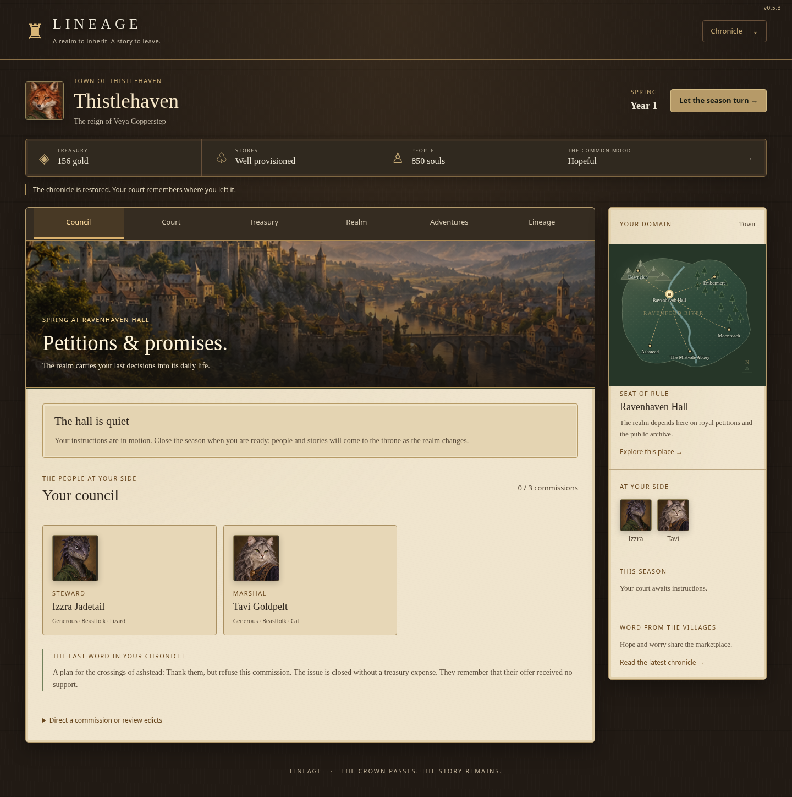
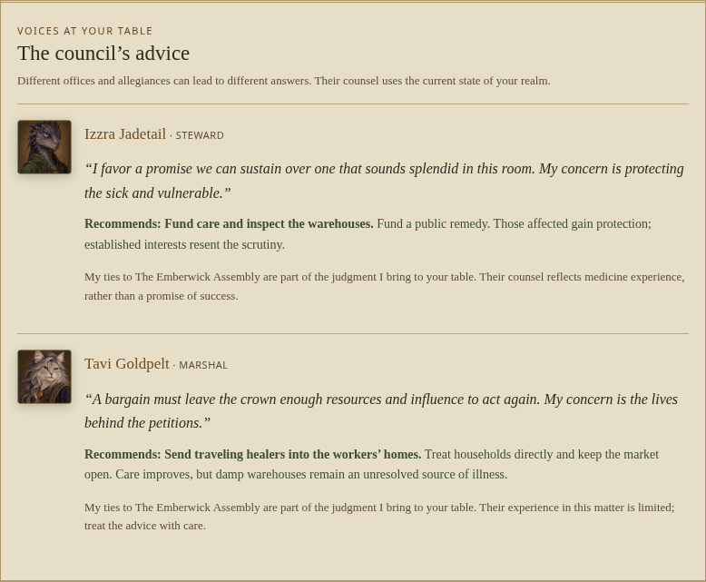
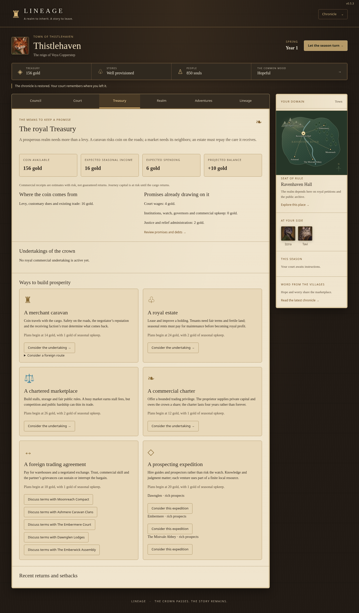
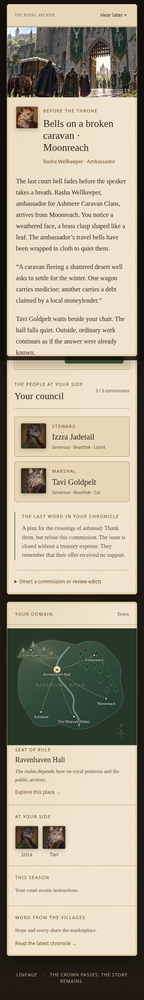

# Lineage 0.5.3 — visual and council review

This revision is on `feature/council-and-parchment`. It is **not deployed**. GitHub Pages still serves `feature/immersion-economy` on 0.5.1. The release label, manifest and browser cache tags identify this build as 0.5.3; the save schema remains 5 and simulation version remains 8.

## Playable phases

1. **Parchment and coin.** Warm ink, accessible muted text and consistent parchment replace conflicting light/dark reading palettes. Wood-toned chrome, illuminated borders and painted landscapes frame the six chapters. Inputs, navigation, hovered choices, disabled choices, reports, dossiers, Treasury, the Chronicle and mobile layouts receive the same treatment. On small screens navigation forms two rows of three chapters. Existing portraits and Beastfolk hair remain intact, with no new portrait overlays.
2. **Council and alternatives.** Direct decisions, popup audiences and seasonal counsel include living advisors’ portraits, commentary and recommendations. Advisors consider their office, actual skill, convictions, faction ties, capped effects, available funds, urgent needs and recorded context. Foreign restitution and contested succession use their real consequences. A second perspective may disagree. Technical forecasts remain available in collapsible ledgers. Advice is deterministic, works offline and changes neither saved state nor the random stream.
3. **Continuity and review.** All 36 opening incidents gain an issue-specific alternative; six gain a second alternative. Six major commissions gain distinct approaches. Shortages, worn institutions and hostile borders gain further choices with actual costs and effects. Original choice IDs remain available. New campaign branches have linked aftermaths, and completed instances remain completed. The review workflow builds downloadable artifacts and runs simulation and browser checks without publishing.

Examples include a maintenance bond or restored flood meadow for a broken sluice, quarantine or traveling healers for a fever, supervised seed trials after smuggling, interpreters at disputed beacons, a public workshop after a guild inheritance, and reduced service during a partial institution repair. These are different budgets and consequences, rather than additional labels for the same ruling.

Coin is rounded **for presentation**, including the resource bar, forecasts, investments, personal wealth, prosperity ambition and detailed ledgers. Fractional commercial shares and precise accounts remain in saves. A near-threshold unaffordable choice explains that the displayed balance is rounded.

## Validation

- `npm test`: **145 passed, 0 failed, 0 skipped**, including 14 new checks for advice, funding restrictions, capped changes, tailored branches, linked aftermaths, old pending petitions, delegation, partial repairs, emergency relief, border restitution, succession and money precision.
- `npm run build`: passed; all browser modules pass syntax checks and the static build includes local art.
- `scripts/council-visual-check.mjs`: **29 desktop/mobile screens and 2,189 computed text contrast checks**, no failures or horizontal overflow. Reading text is checked against WCAG AA thresholds. Painted-image captions and map labels were visually inspected; native disabled controls and image captions are excluded from the computed contrast assertion.
- Existing browser, enhancement and portrait checks: passed. Creation, saving/import, hiring/transfer/dismissal, mentorship, seasonal reports, commerce, dynasty navigation, Chronicle, mobile layouts, existing portrait identities, overlay removal and hairless lizards remain functional. No JavaScript errors or missing artwork.
- Both century scripts: town and province each reach Year 101 over **400 seasons and three reigns**. Ordinary management has no foodless seasons. Commercial simulations retain bounded operations and receipts; largest seasonal commercial receipts are 49/47 gold and lifetime net commercial returns are 24/173 gold. Final compact saves remain under 3 MB.
- A direct comparison against 0.5.2 across seeds 41, 72 and 914 preserves the initial random stream, resources, generated world and **631 complete character identities**, including their portraits. Additional followup wording does not consume extra generation rolls.

The contrast audit and century results are stored alongside the screenshots. CI uploads a build and a separate visual review artifact. Runtime dependencies and external services remain unnecessary.

## Screenshots

The council uses parchment reading surfaces and a dark map and chapter bar:

Advisors make named recommendations with their own priorities and ties:

Treasury income, expenses and opportunities use the same readable palette:

Mobile audiences retain illustrated context, portraits and actionable choices:

## Practical limits

Advisor recommendations are explainable heuristics, not an optimal strategy or a guarantee of successful work. Offices can favor different interests. The existing event engine and authored scenes remain finite, while subsequent circumstances and their causal histories continue to evolve. The optional ledgers display rounded coin, so displayed changes and displayed balances can differ by a rounding boundary; precise accounts remain available in exported saves. Only merging or publishing after review should change production.
