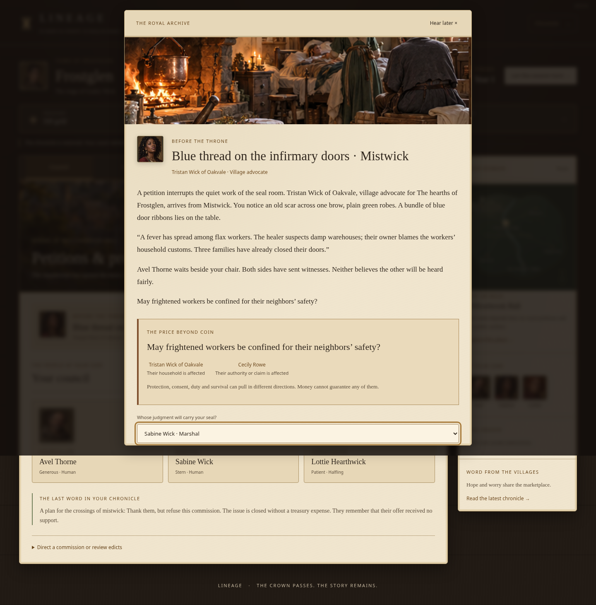
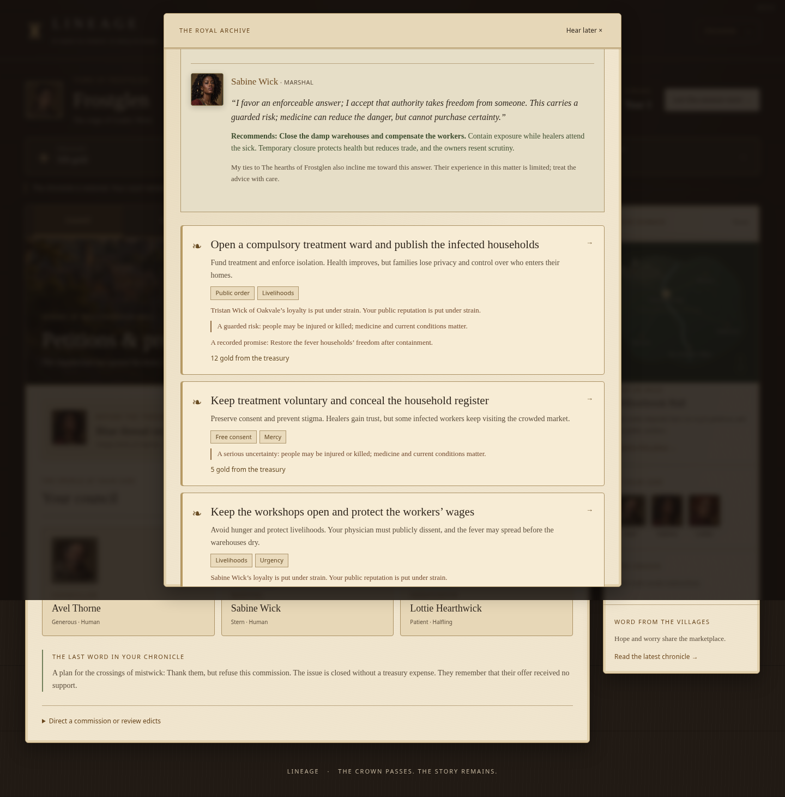
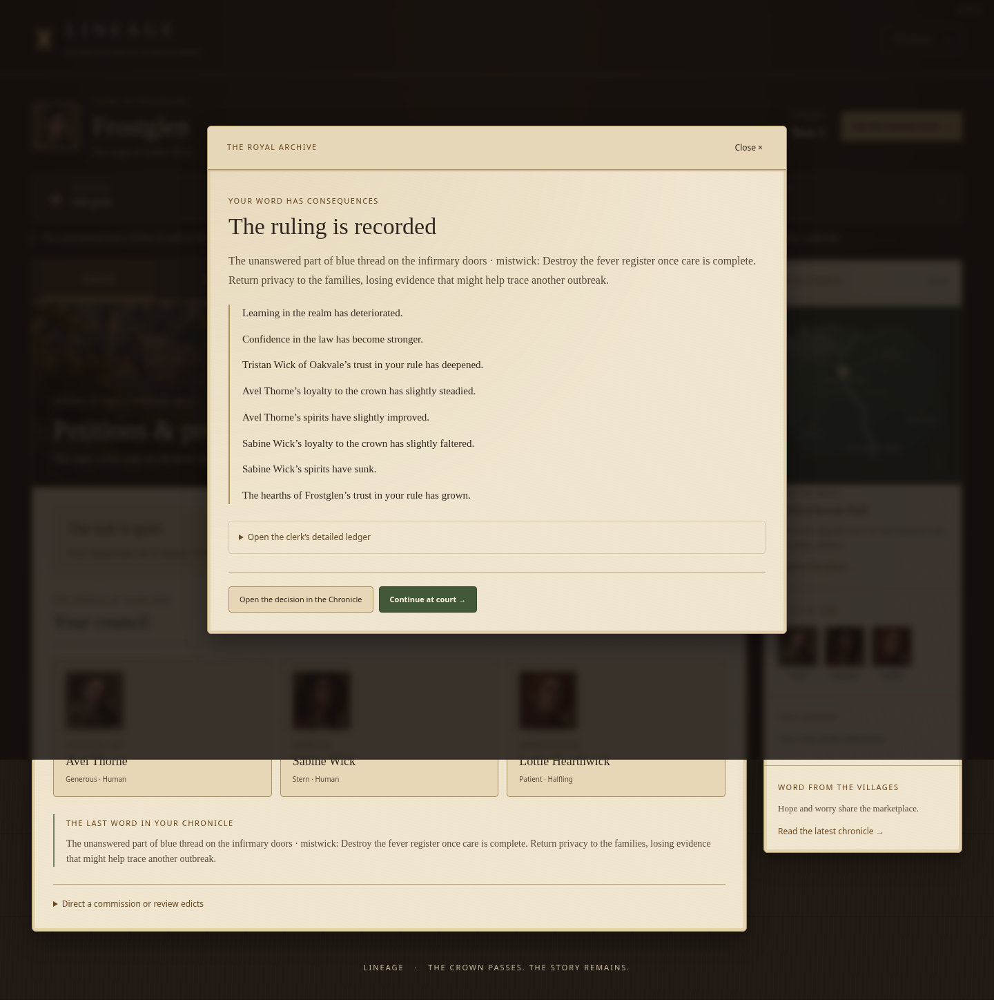
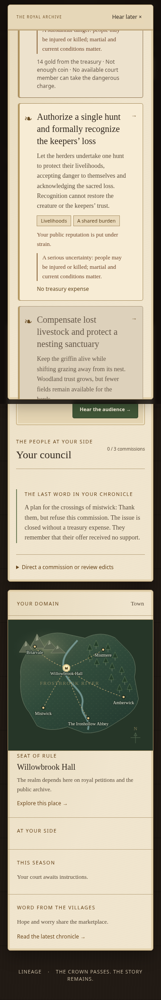

# Lineage 0.5.4 — Moral dilemmas and living consequences

A costly answer previously tended to buy a better version of the same outcome. This revision gives the 36 opening incidents different conflicts about consent, truth, duty, authority, livelihoods and survival. Five continuing world pressures also receive moral stakes. Strategic commissions, commerce and the other existing systems retain their own mechanics.

This is a review build on `feature/moral-dilemmas`, based on the merged 0.5.3 visual update. Production is unchanged. GitHub Pages still serves `feature/immersion-economy` on 0.5.1.

## Choices that cost more than coin

- **A failing sluice:** breach an estate’s meadow to protect homes, evacuate families and promise lasting shelter, preserve irrigation while risking downstream lives, require a maintenance bond, or surrender cultivated land to a flood meadow.
- **A fever:** enforce treatment at the cost of privacy and consent, preserve voluntary care while risking further infection, protect wages while the illness spreads, quarantine warehouses, or send traveling healers. The expensive compulsory ward still damages justice, loyalty and royal reputation.
- **A missing scout:** risk the scout’s comrades, bargain with a suspect traveler, or keep patrols protecting the many people who still use the border. A public inquest, pensions and confidentiality raise different questions in the aftermath.
- **An ill veteran:** order leave, share command confidentially, or let the company choose after public disclosure. Returning to command requires sufficient health. A teaching appointment changes the actual office and profession. A fallen officer can receive a memorial, releasing an impossible return promise.

Choices display their commitments, personal costs, qualitative danger and recorded promises. Watch strength, stored food, personal loyalty and foreign trust can constrain decisions independently of gold. An empty treasury and unavailable court still leave an opening response; free choices carry their own costs.

There is no good/bad score. Advisors weigh their real traits, offices, faction ties and personal interests alongside practical conditions. A principled, compassionate councillor can disagree with a ruthless marshal even when every answer is affordable. Advice remains a deterministic reading of state and consumes no simulation rolls.

## Persistent consequences

Dangerous work occupies the chosen living court member until the report arrives. Skill, loyalty, public conditions and, where relevant, royal reputation affect a bounded chance of harm. More spending cannot guarantee safety. The outcome draw is derived from the campaign seed and the undertaking’s identity, choice and due season; loading or reopening a report cannot reroll it.

Reports record actual civilian losses, wounds and named deaths. Deaths use the existing inheritance, spouse and governor systems, with a causal link from the ruling to its report and then to the death. The settlement census is reapportioned after losses. Court convictions also change actual loyalty and morale; historical records retain the values before and after the reaction.

Each issue has authored aftermath choices instead of a universal “continue / local / closed” menu. The aftermath includes the actual preceding ruling, participants and report. Pledges enter Promises & obligations with deadlines. Specific promises require the promised act; an unrelated settlement can break them and damage reputation and trust. Overdue promises lose trust once and remain outstanding until addressed. Later rulers inherit the unresolved question and the recorded history.

Hunger, worn institutions, border disputes, displaced succession claims and court rivalry keep their original debt, repair, ownership, estate and relationship effects while adding competing commitments and tailored aftermaths. In particular, guild grain remains a real loan of eight gold, not a free grant.

## Compatibility and phases

The existing modular simulation now has an authored catalogue, persistent undertaking engine, moral beliefs/advice and presentation helpers. Implementation proceeded through playable catalogue/integration, delayed consequence/continuity, and browser/review phases. The runtime has no dependencies, online narrative calls or new credentials.

Save schema remains **5**; simulation version advances to **9**. Older pending petitions retain their recorded options, prices and consequences rather than being rewritten at import. New living-world issues use the revised rules. Identity, portraits, world generation, history, dynasty and the production workflow remain intact. Module cache tags and the upper-right version display are updated to 0.5.4.

## Validation

- `npm test`: **167 passed, 0 failed, 0 skipped**. The 22 new tests cover moral tradeoffs, nonfinancial conditions, conflicting advice, actual reactions, delegation and occupation, skill-sensitive risk, save/replay identity, named deaths and inheritance, census/causality, fulfilled/broken/overdue promises, dead and reigning subjects, real teaching appointments, multigenerational obligations, all five live pressures, import validation, legacy decisions and ordinary expedition dispatch.
- `npm run build`: passed; the static build contains the local artwork and all browser modules.
- All five browser suites passed: core gameplay, enhancements, portrait polish, council/contrast review and the new moral interaction suite. They cover delegate selection, actual delayed reports, promise completion and a free mobile answer without an available court. No JavaScript errors or missing assets.
- Contrast review: **29 screens / 2,243 text checks**, zero failures or horizontal overflow. Reading text uses WCAG AA thresholds; image captions, map art and native disabled controls are inspected separately. Desktop and 360px moral choices were visually inspected.
- Both century scripts pass for town and province at Year 101, **400 seasons and three reigns**. Ordinary management has zero seasons without food and 118 unique emergent petitions in each scale. Commercial runs record real failures, largest seasonal receipts of 47/48 gold and lifetime net commercial returns of 137/276 gold. Final saves remain below 3.2 MB.
- Direct comparison with committed 0.5.3 over seeds 81, 914 and 2026 at both scales preserves **1,262 character identity comparisons**, full portraits, initial world/settlements/relationships/resources and the random stream.

CI runs the same tests, build, century simulations and five browser suites. It provides downloadable build and visual-review artifacts without deploying this branch.

## Review images and records

Raw results: [contrast audit](review-images/0.5.4/contrast-audit.json), [ordinary century simulation](review-images/0.5.4/century.json), [commercial century simulation](review-images/0.5.4/commerce-century.json).
