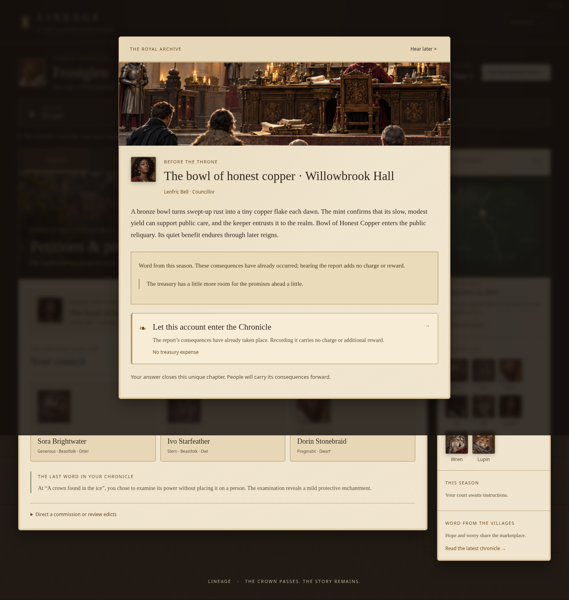
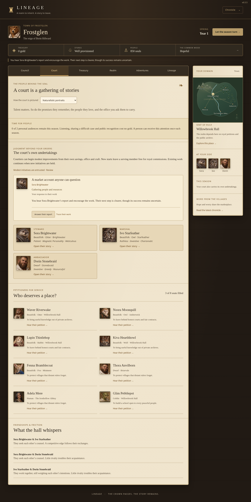
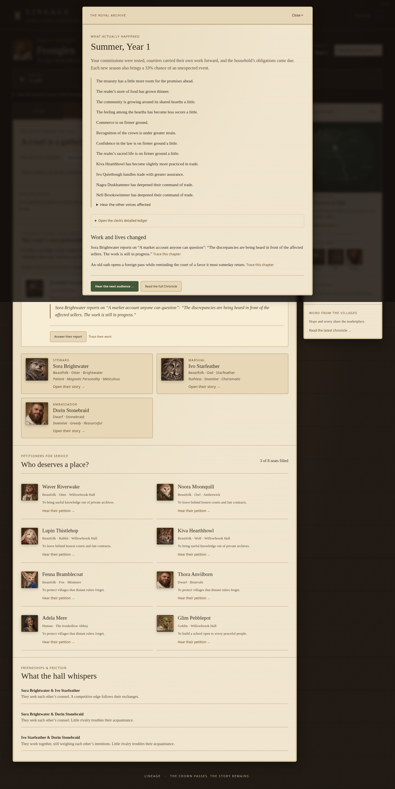
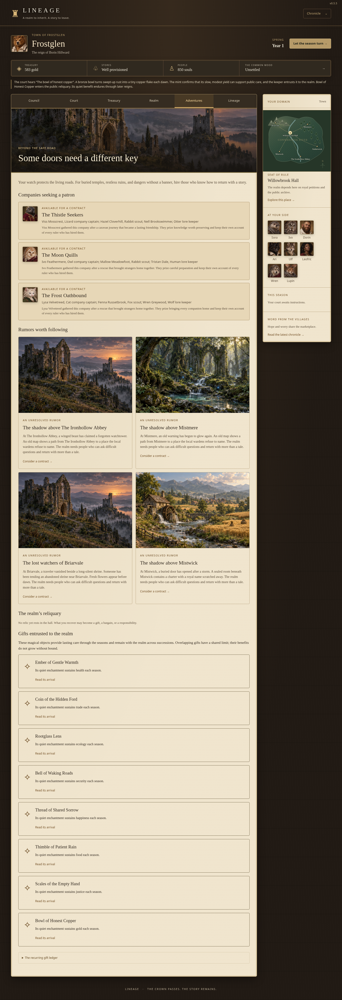
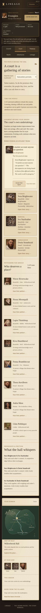

# Lineage 0.5.5 — Unexpected seasons and a court with its own purpose

A realm should sometimes bring good fortune, hardship or an unexpected dilemma without a royal commission. Courtiers should also bring their own judgment and resources to public work, while personal attention should not require a treasury payment. This revision adds those systems to the merged 0.5.4 game.

This review build is on `feature/seasons-and-court`. Production remains unchanged: GitHub Pages still serves `feature/immersion-economy` on 0.5.1.

## The seasonal event database

Each completed seasonal turn receives exactly one **33%** lottery check, independently of the existing living-world petitions and consequences. No roll occurs when a waiting audience blocks advancement. The seed and season determine the draw without consuming the simulation’s existing random stream. Loading, acknowledging an occurrence or reading its forecast cannot reroll it.

The authored database contains **208 unique entries**:

| Category | Entries | Behavior |
| --- | ---: | --- |
| Positive | 51 | Immediate benefits, including funds, stronger public conditions, heroes and lasting magical gifts |
| Negative | 50 | Immediate losses or setbacks to funds, stores and public conditions |
| Mixed | 50 | A benefit with a corresponding cost, such as stronger trade at the expense of reserve food |
| Decision | 57 | Three distinct approaches, including a free answer and uncertain outcomes influenced by the selected courtier |

Examples include a lawful silver cache, goblin pumps, gnoll road guides, bees settling in an orchard, mold in the reserve, a damaged crossing, profitable exports that empty stores, a ransom for someone already rescued, an uncertain ancient remedy, and a memorial cairn blocking a new road. These are authored occurrences with different circumstances and effects, rather than repeated names attached to one outcome.

Entries are drawn without replacement. Positive, negative and mixed effects are applied once when the occurrence is recorded; the subsequent popup is a free report, not another reward or penalty. Decision benefits are not applied in advance. The chosen branch may achieve its intended result or its recorded setback. Advisors weigh the actual possible outcomes and their own convictions; dangerous charges require an available living court member. Every decision still has a free approach when the treasury is empty and no courtier is available.

After the authored catalogue is exhausted, new responses can draw on fresh actual Chronicle causes, using each cause/category pair once. Completed catalogue events and rewards remain completed across saves and rulers.

## Heroes and magical gifts

Seven heroic arrivals use prepared character identities. Names, race/species and portraits remain consistent. A hero joins without an entrance payment if a court seat is free, or offers service from the recruitment roster if the court is full. Continuing wages and ordinary court capacity still apply. Heroic service and achievements enter the Chronicle and the person’s profile.

Nine magical objects provide recurring boons, including the Thimble of Patient Rain, Ember of Gentle Warmth, Bell of Waking Roads, Coin of the Hidden Ford and Bowl of Honest Copper. They belong to the realm across successions. Aggregate recurring effects are limited to two units per season for coin/food and one for other conditions. Gifts are visible in Adventures; coin and food contributions appear in Treasury and seasonal forecasts. They are counted once, including when determining the money available for wages. Small food gifts do not bypass genuine shortages.

Uncertain undertakings can injure or kill the actual delegate. A death records the undertaking’s place and causal ruling and uses the existing inheritance, spouse and governor systems. It does not erase the person’s identity or historical service.

## Personal time instead of a fee

Listening privately, sharing a difficult case and recognizing service cost **zero gold**. Each uses one personal audience. Towns have two each season, provinces/cities three, and kingdoms four. A conventional personal visit or recognition is limited to once per person per season. Kin can receive this attention too. Encouraging a court undertaking also uses the shared budget. The calendar renews the budget, and Court displays how much remains.

Material help, retainers, ceremonies and investments retain their appropriate costs. Free personal time is bounded by the ruler’s attention, allowing relationships to matter without making unlimited repeated rewards available.

## Work courtiers choose themselves

There are **20 initiatives**, four for each office:

| Office | Examples |
| --- | --- |
| Steward | Seed reserves, water surveys, public market accounts, useful winter work |
| Marshal | Voluntary watch training, company drill, escort schedules, equipment care |
| Ambassador | Road correspondence, shared glossaries, minor-grievance tables, guest rights |
| Spymaster | Neglected weaknesses, accountable receipts, safe witnesses, tested rumors |
| Councillor | Healing visits, open lessons, common gardens, craft circles |

Courtiers begin suitable work according to their real skills, loyalty, health, morale, connections, traits, private wealth and free capacity. They pay from their own savings. An initiative occupies its founder, has a cooldown, takes several seasons, can stall or produce only a partial result, and has diminishing returns when the same work repeatedly improves the same settlement. New starts leave a courtier free for royal work when others already have commitments.

Courtiers report actual progress and completion. Reports appear in Council, Court, profiles, the seasonal account and the Chronicle, with linked causes and professional milestones. The ruler may hear and encourage a report for personal time, supply materials for six gold, or end the work without recovering spent funds. Holding new starts leaves existing work to continue. Death, dismissal, an incompatible office or accession ends a founder’s work without phantom completion. A new ruler otherwise inherits the ongoing initiative and its reports.

## Compatibility and architecture

The implementation extends the existing modular architecture with a seasonal catalogue/engine, court initiative engine and presentation helpers. Save schema remains **5**, with simulation version **10**. Existing worlds, identities, portraits, businesses, historical records and pending moral decisions are retained. Older saves gain empty new systems at their current turn; no retrospective lottery or private work is applied. Stored event definitions preserve pending choices and their consequences.

Implementation and validation proceeded through playable catalogue integration, personal time/court work, then accounting, continuity and browser review. Runtime dependencies and external narrative services remain unnecessary. Version display and module cache tags are 0.5.5; the production workflow is unchanged.

## Validation

- `npm test`: **203 passed, 0 failed, 0 skipped**, including 36 new tests for catalogue content, lottery distribution/idempotence, one-time effects, hero capacity and identity, boons/accounting, uncertain outcomes and advice, free attention, actual private funding, court availability, progress and milestones, interventions, death/office/succession, causality and import compatibility.
- `npm run build`: passed; all modules pass syntax checks and the static build includes local artwork.
- All **six browser suites** pass. The new suite exercises real popups, selected delegates and actual outcomes, heroes, lasting gifts/Treasury, zero-gold attention, the shared time budget, initiative reports through a real seasonal advance, save persistence and mobile play without an available court. The older commerce suite now resolves incoming seasonal audiences before continuing its existing checks.
- Contrast review: **41 screens / 2,946 text checks**, zero failures or horizontal overflow. New automatic reports, uncertain decisions, gifts and initiative responses are included. Reading text is checked against WCAG AA thresholds; artwork labels and native disabled controls are inspected separately. Desktop and 360px layouts were visually inspected.
- Both century scripts pass for town and province at Year 101 over **400 seasons**. Ordinary management spans three rulers with zero foodless seasons and 111/117 unique emergent petitions. Commercial runs span two rulers, retaining 30/44 failed receipts, largest seasonal receipts of 47/48 gold and lifetime net commercial returns of 736/669 gold. Final saves remain below 4.3 MB.
- A comparison with committed 0.5.4 across three seeds and both scales preserves **1,262 complete identity comparisons**, portraits, initial world/settlements/relationships/resources and the initial random stream.

The review workflow runs tests, builds, both century simulations and all six browser suites. It uploads a downloadable game build and review images without deploying this branch.

## Screenshots and records

Raw records: [contrast audit](review-images/0.5.5/contrast-audit.json), [ordinary century](review-images/0.5.5/century.json), [commercial century](review-images/0.5.5/commerce-century.json). The complete authored database is [seasonal-catalog.js](../src/seasonal-catalog.js).
